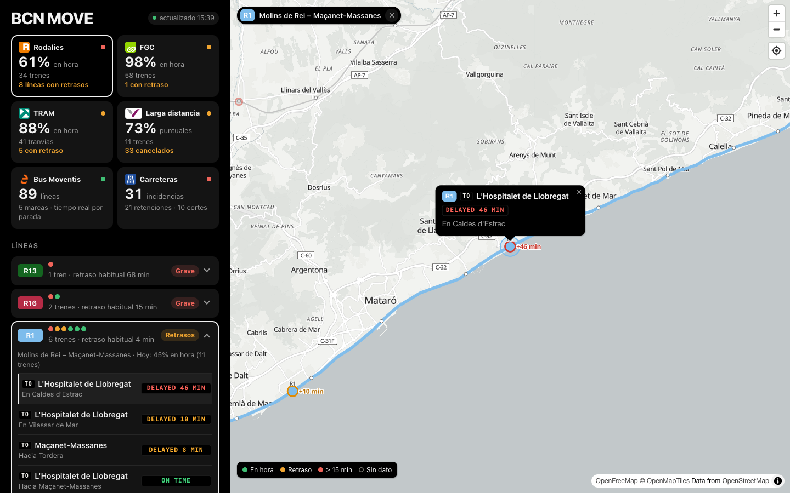
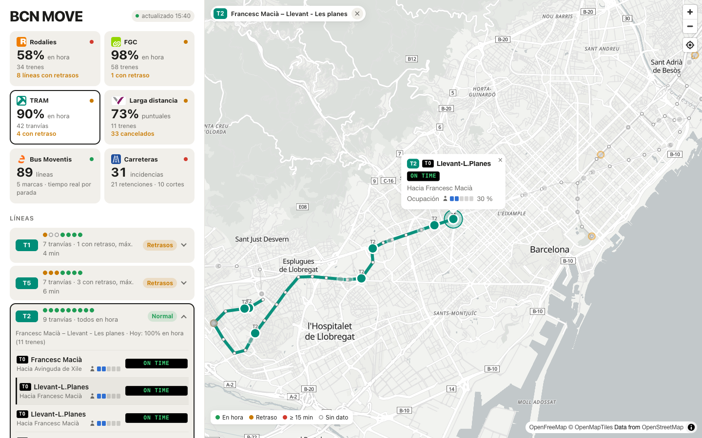
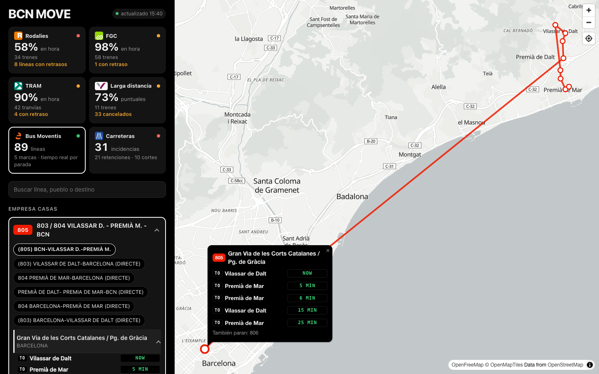
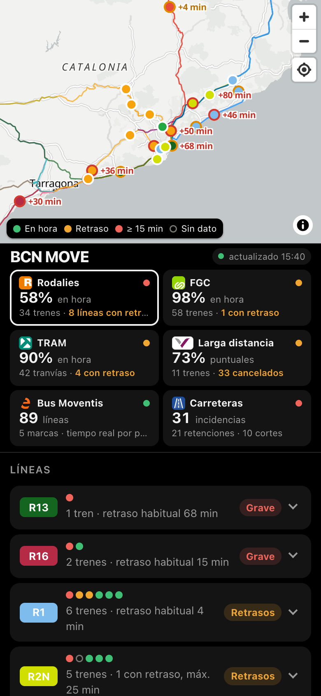

# BCN MOVE

Trenes, tranvías, autobuses y carreteras de Catalunya en directo: Rodalies, FGC, TRAM, AVE y larga distancia, bus Moventis e incidencias del Servei Català de Trànsit, todo a partir de datos abiertos oficiales.

**En directo:** https://movilidad-bcn.vercel.app



| TRAM | Bus Moventis | Móvil |
|---|---|---|
|  |  |  |

> Información no oficial. Este proyecto no está afiliado a Renfe, FGC, TRAM, Moventis ni a la Generalitat de Catalunya.

## Qué muestra

- **Rodalies:** posición y retraso de cada tren, destino, vía, avisos oficiales y obras previstas.
- **FGC:** posición, retraso en minutos (calculado con el horario) y ocupación de cada tren.
- **TRAM** (Trambaix y Trambesòs): retraso, próxima parada y ocupación de cada tranvía, con su posición estimada.
- **AVE y larga distancia:** trenes de Renfe que paran en Catalunya, agrupados por corredor (Madrid, Francia, Andalucía, València…), con cancelaciones.
- **Bus Moventis:** 89 líneas con los próximos buses de cada parada, en tiempo real o según horario.
- **Carreteras:** retenciones y cortes del Servei Català de Trànsit, con el código de color de la señalización española.

## Cómo se usa

- **Compañías:** las tarjetas de arriba son el resumen de cada una y, a la vez, sus pestañas. El mapa muestra solo la compañía elegida, y la pestaña queda en la URL (`#rodalies`, `#fgc`, `#tram`, `#ave`, `#bus`, `#carreteras`).
- **Líneas:** cada línea, o corredor en AVE, es una pastilla con un punto por tren (verde en hora, naranja con retraso, rojo con 15 min o más, hueco sin dato) y una frase que la resume, por ejemplo «9 trenes · retraso habitual 40 min». Al pulsarla se despliegan sus trenes, del peor al mejor, con su destino (`TO …`), dónde están y un indicador de estado tipo panel de aeropuerto (`ON TIME`, `DELAYED 12 MIN`).
- **Selección en el mapa:**
  - Al desplegar una línea o pulsar un tren, su vía sale en color, más gruesa y por encima de las demás, y el resto pasa a gris.
  - En el mapa, cada tren con retraso lleva al lado «+N min».
  - En AVE se dibuja el recorrido del tren uniendo sus estaciones.
- **Móvil:** la pantalla se divide en tres: mapa arriba, selectores de transporte en el centro y líneas abajo.

## Arrancar en local

Requiere Node 20 o superior. No tiene dependencias.

```bash
npm run preparar   # opcional: regenera los datos estáticos (el repositorio ya trae unos)
npm start          # http://127.0.0.1:8080
```

Para usar otro puerto: `PORT=3000 npm start`. El servidor local sondea las fuentes de forma continua, guarda una muestra del estado cada 5 minutos en `data/historial.jsonl` y regenera los datos estáticos una vez al día.

## Desplegar en Vercel

El repositorio está listo para Vercel ([vercel.json](vercel.json)): al importarlo en vercel.com/new no hay que configurar nada.

- **Página:** se sirve tal cual desde `public/`.
- **Datos estáticos:** se regeneran en cada despliegue. Si falla la descarga, se usan los del repositorio.
- **API:** son funciones ([api/](api/)) sobre el mismo motor que el servidor local ([lib/engine.mjs](lib/engine.mjs)). Cada petición refresca solo las fuentes caducadas, y la CDN de Vercel comparte la respuesta entre visitantes: 10 s los trenes y 120 s las carreteras.
- **Región:** las funciones corren en París (`cdg1`), cerca de las fuentes.

Diferencias con el servidor local:

- **Estado en memoria:** «Directo», «en lo que va de día» y la confirmación de retrasos en dos lecturas solo duran mientras la función siga activa.
- **Sin historial:** no hay `/api/history`.
- **Límite de FGC:** sus 5.000 peticiones al día por IP se comparten con otros proyectos que salgan por la misma IP de Vercel.
- **Datos estáticos:** solo se renuevan al volver a desplegar. Conviene hacerlo al menos una vez por semana, porque el horario de FGC cubre 8 días y los `trip_id` de Renfe cambian con cada periodo de horarios.

## Cómo funciona

```
Renfe GTFS-RT ────┐ cada 15 s
FGC Geotren ──────┤ cada 30 s
FGC GTFS-RT ──────┤ cada 60 s        ┌──────────────────┐  /api/live (+ x-data-next)  ┌───────────┐
TRAM StopTimes ───┤ cada 20 s   ───► │  lib/engine.mjs  │ ──────────────────────────► │ navegador │
Renfe GTFS-RT LD ─┤ cada 30 s        │  (server.mjs o   │  /api/carreteras            └───────────┘
Avisos Renfe ─────┤ cada 60 s        │   funciones api/)│  /api/bus-*  (bajo demanda)
SCT (GML) ────────┘ cada 3 min       └──────────────────┘
```

El navegador no habla con los operadores: pregunta a la API, que le indica en la cabecera `x-data-next` cuándo tendrá datos nuevos. El siguiente sondeo se programa entre 2 y 12 s, y cada tren se desliza de su posición anterior a la nueva.

| Archivo | Qué hace |
|---|---|
| `lib/engine.mjs` | Motor: consulta las fuentes, calcula el estado de cada línea y arma las respuestas |
| `lib/moventis.mjs` | Bus Moventis: líneas, paradas y próximos buses, con caché |
| `lib/gtfs-rt.mjs`, `lib/zip.mjs` | Lectores de GTFS-RT (protobuf) y de .zip, sin dependencias |
| `scripts/preparar-datos.mjs` | Descarga los horarios oficiales y genera `data/` y `public/data/` (estaciones, colores, vías, destinos) |
| `server.mjs` | Servidor local: sondeo continuo, historial, API y página |
| `api/` | Funciones de Vercel: `/api/live`, `/api/carreteras`, `/api/bus-lineas`, `/api/bus-paradas`, `/api/bus-tiempos` |
| `public/` | Página: mapa MapLibre con OpenFreeMap, pestañas, líneas y avisos |

## Fuentes de datos

| Red | Fuente | Clave |
|---|---|---|
| Rodalies | Renfe Data: GTFS-RT de Cercanías (`gtfsrt.renfe.com`, posiciones, retrasos y avisos) y GTFS estático | No |
| AVE y larga distancia | Renfe Data: GTFS-RT LD (`vehicle_positions_LD.json`, `trip_updates_LD.json`) y GTFS AV/LD | No |
| FGC | FGC Dades Obertes (`dadesobertes.fgc.cat`): `posicionament-dels-trens`, `trip-updates-gtfs_realtime` y `gtfs_zip` | No (límite de 5.000 peticiones al día por IP) |
| TRAM | TRAM OpenData (`opendata.tram.cat/api/v1`): `lines`, `lines/{id}/stops` y `StopTimes` | No |
| Bus Moventis | JSON públicos de su página «Tiempo real» (`www.moventis.es`) | No (no son datos abiertos oficiales) |
| Carreteras | Servei Català de Trànsit, datos abiertos de la Generalitat (`incidenciesGML.xml`) | No |
| Mapa | OpenFreeMap (estilo Positron), datos © colaboradores de OpenStreetMap | No |

Cada fuente tiene sus propias condiciones de uso; la página las cita en «Cómo se hace».

## Criterios

- Un tren va **en hora** con 3 min de retraso o menos (criterio de Renfe para Cercanías). En AVE y larga distancia, **puntual** es menos de 5 min.
- Un retraso de Renfe solo cuenta si se **repite en dos lecturas seguidas**.
- **En lo que va de día:** cada tren cuenta una sola vez, con el último retraso que publicó.
- **Estado de una línea** (aproximación sin horarios de andén):
  - **Grave:** el retraso mediano de sus trenes llega a 15 min.
  - **Retrasos:** el retraso mediano pasa de 3 min, o algún tren lleva 15 o más.
  - **Aviso:** hay un aviso oficial activo y los trenes van en hora.
- **FGC y AVE:** también son **Grave** si la mitad o más de sus trenes van con retraso. En AVE se cuentan los que llevan 15 min o más.

## Notas técnicas

### Minutos de retraso en FGC

FGC no publica el retraso, solo la hora prevista de llegada a cada parada, en GTFS-RT con formato protobuf (se lee con [lib/gtfs-rt.mjs](lib/gtfs-rt.mjs), sin dependencias).

- **Cálculo:** el retraso es la hora prevista menos la programada en la próxima parada, según `data/fgc-horarios.json`, que va de ayer a dentro de 8 días.
- **Cruce de viajes:** en tiempo real el `trip_id` lleva otro prefijo de servicio que en el horario, así que se cruza por el código de viaje (lo que va tras `|`). Si el código se repite en varios servicios del día, se elige el más cercano a la previsión.
- **Sin previsión:** se usa el «en hora» oficial de FGC.
- **Límite diario:** posiciones cada 30 s (2.880 peticiones) + previsiones cada 60 s (1.440) = 4.320 al día.

### AVE y larga distancia

- **Qué trenes salen:** AVE, Avlo, Alvia, Euromed, Intercity y Avant que paran en Catalunya. MD y regionales quedan fuera porque ya son las líneas R1x de Rodalies.
- **Corredor:** cada tren se asigna a uno según su recorrido en el horario oficial.
- **Variantes duplicadas:** Renfe publica cada tren una vez por variante de recorrido. Se queda la variante con más paradas, y las cancelaciones se agrupan igual.
- **Hora del feed:** la marca de tiempo del feed de posiciones LD va una hora por detrás, así que se usa la hora de recepción.

### TRAM

- **Datos:** para cada parada y sentido, la hora prevista y la programada de los próximos tranvías, con su ocupación (de `EMPTY` a `FULL`).
- **Retraso:** la diferencia entre las dos horas en la próxima parada.
- **Posición:** no se publica. Se estima entre la parada anterior y la siguiente según lo que falta para llegar.
- **Trazado:** se dibuja uniendo las paradas en orden.

### Bus Moventis

- **Qué cubre:** Empresa Casas, Moventis, Sarbus, Sarfa y TCC Barcelona, 89 líneas.
- **Sin posición:** Moventis no publica dónde están los buses, solo los próximos pasos por parada. Por eso funciona bajo demanda: líneas → recorridos y paradas → próximos buses de la parada elegida.
- **Cachés:** líneas y paradas 12 h; tiempos de una parada 30 s.
- **Fuente no oficial:** no es una API publicada, así que puede cambiar sin aviso.

### Carreteras: código de color

Cada carretera lleva el color de los hitos kilométricos españoles. El SCT no publica el tipo de vía, así que se deduce del código:

| Color | Red | Códigos |
|---|---|---|
| Azul | Autopista o autovía | `A-`, `AP-` y una lista fija (aproximada) de autovías catalanas: C-16, C-17, C-25, C-31, C-32, C-33, C-58, C-60, B-10, B-20, B-23, B-30, B-40, T-11 |
| Rojo | Red del Estado | `N-` |
| Naranja | Generalitat, red básica (1.er orden) | `C-` de 1 o 2 cifras |
| Verde | Generalitat, comarcal y local (2.º orden) | `C-` de 3 o más cifras; `B-`, `GI-`, `L-`, `T-` de hasta 3 cifras |
| Amarillo | Diputaciones (3.er orden) | `BV-`, `BP-`, `GIV-`, `GIP-`, `TV-`, `TP-`, `LV-`, `LP-` |
| Verde redondeado | Itinerario europeo | `E-` |

### Logos

Los logos de [public/logos/](public/logos/) son marcas registradas de sus operadores y se usan solo para identificar cada servicio:

| Archivo | Origen |
|---|---|
| `rodalies.svg` | Símbolo con la «R», recortado de *Rodalies de Catalunya logo.svg* (Wikimedia Commons) |
| `fgc.svg` | *FGC logo (2019).svg* (Wikimedia Commons) |
| `ave.svg` | *AVE.svg* (Wikimedia Commons) |
| `tram.svg` | *Tram Barcelona negative.svg* (Wikimedia Commons), sobre el verde del TRAM |
| `moventis-e.png` | La «e» del logotipo de Moventis |

El icono de Carreteras es un pictograma genérico dibujado para esta página.

## Limitaciones y pendientes

- **Metro y bus de TMB:** su API pide una clave gratuita de developer.tmb.cat (`TMB_APP_ID` y `TMB_APP_KEY` en `.env`); todavía no está integrada.
- **Sin datos abiertos en tiempo real:** Ouigo e Iryo no los publican, y Renfe no publica avisos de AVE y larga distancia en GTFS-RT.
- **Posiciones y recorridos:** la posición se interpola en línea recta entre lecturas o paradas, no a lo largo de la vía, y el recorrido de los buses une las paradas en línea recta.

## Licencia

El código se publica con licencia [MIT](LICENSE). Los datos, los logotipos y el mapa base tienen sus propias condiciones; están detalladas en el [LICENSE](LICENSE).
